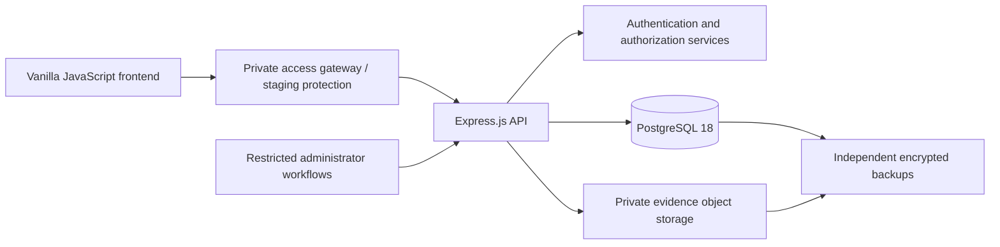

# NandedConnect PostgreSQL Database Design

**Status:** Phase 3 design document — design only, not an implementation

**Target:** PostgreSQL 18-compatible production design for a private staging environment

**Related documents:** [PRODUCT_REQUIREMENTS.md](./PRODUCT_REQUIREMENTS.md), [SYSTEM_ARCHITECTURE.md](./SYSTEM_ARCHITECTURE.md), [ARCHITECTURE_DECISIONS.md](./ARCHITECTURE_DECISIONS.md)

This document defines the proposed relational model for NandedConnect. It does not create tables, migrations, SQL, database connections, APIs, or deployment resources.

## 1. Design scope and principles

The database will support a production-ready local business discovery platform for Nanded while the product remains private and launch-controlled. The design preserves the approved decisions:

- Node.js and Express.js own application workflows; PostgreSQL is the system of record.
- One user account may have multiple roles. Administrative roles are assigned through controlled server-side workflows and are never self-assigned.
- Authentication uses secure server-side sessions and Argon2id password hashes. Plaintext passwords, reusable reset tokens, and raw OTP values are never stored.
- Business verification combines phone OTP and manual administrator review of business details and appropriate supporting evidence. There is no universal GST/Aadhaar requirement.
- Each business has one active primary owner, with future manager support. Claims and transfers require verification and administrator approval.
- Reviews are authenticated, one per customer per business, editable, reportable, and moderated. The database must not claim verified purchases without supporting evidence.
- Inquiry access is restricted to the customer and authorized business users. Direct WhatsApp and phone actions are external contact actions; only web-form inquiries are stored unless a later decision adds provider integration.
- Public registration, submissions, reviews, inquiries, and indexing remain disabled until explicit product-owner approval and corresponding feature flags are enabled.
- Frontend hiding and `noindex` are not security controls. API authorization, database privileges, status predicates, and launch controls must enforce the same restrictions independently.

The current application is a static vanilla frontend with [`index.html`](../index.html), [`data.js`](../data.js), [`script.js`](../script.js), and [`style.css`](../style.css). Its browser-local demo data and localStorage behavior are not the production persistence model; migration of approved data will require a separate implementation decision.

## 2. System boundary

The proposed database sits behind the Express API. Browsers never receive database credentials, direct database access, verification evidence, password hashes, session token material, private audit data, or unrestricted business records.

## 3. Entity relationship diagram

The diagram shows the core relationships. Operational audit and security tables are included even where they do not participate in customer-facing workflows.

```mermaid
erDiagram
    USERS ||--|| USER_PROFILES : has
    USERS ||--o{ USER_ROLES : receives
    ROLES ||--o{ USER_ROLES : grants
    USERS ||--o{ SESSIONS : opens
    USERS ||--o{ PASSWORD_RESET_TOKENS : requests
    USERS ||--o{ EMAIL_VERIFICATION_TOKENS : verifies

    CATEGORIES ||--o{ BUSINESSES : classifies
    LOCALITIES ||--o{ BUSINESSES : contains
    BUSINESSES ||--o{ BUSINESS_CONTACTS : exposes
    BUSINESSES ||--o{ BUSINESS_LOCATIONS : locates
    BUSINESSES ||--o{ BUSINESS_HOURS : schedules
    BUSINESSES ||--o{ BUSINESS_SERVICES : offers
    BUSINESSES ||--o{ BUSINESS_OWNERS : assigned_to
    USERS ||--o{ BUSINESS_OWNERS : owns_or_manages
    BUSINESSES ||--o{ BUSINESS_MEMBERSHIPS : has_memberships
    USERS ||--o{ BUSINESS_MEMBERSHIPS : receives_assignment
    USERS ||--o{ INQUIRY_ASSIGNMENTS : assigned_manager
    BUSINESSES ||--o{ INQUIRY_ASSIGNMENTS : authorizes
    INQUIRIES ||--o{ INQUIRY_ASSIGNMENTS : assigned_to
    BUSINESSES ||--o{ OWNERSHIP_CLAIMS : receives
    USERS ||--o{ OWNERSHIP_CLAIMS : makes
    BUSINESSES ||--o{ BUSINESS_SUBMISSIONS : receives
    USERS ||--o{ BUSINESS_SUBMISSIONS : submits

    BUSINESSES ||--o{ VERIFICATION_REQUESTS : undergoes
    USERS ||--o{ VERIFICATION_REQUESTS : requests
    VERIFICATION_REQUESTS ||--o{ VERIFICATION_DOCUMENTS : contains
    USERS ||--o{ VERIFICATION_DOCUMENTS : uploads

    USERS ||--o{ FAVORITES : saves
    BUSINESSES ||--o{ FAVORITES : saved_as
    USERS ||--o{ RECENTLY_VIEWED : views
    BUSINESSES ||--o{ RECENTLY_VIEWED : viewed_as

    USERS ||--o{ REVIEWS : writes
    BUSINESSES ||--o{ REVIEWS : receives
    REVIEWS ||--o{ REVIEW_REPORTS : reported
    USERS ||--o{ REVIEW_REPORTS : reports

    GUEST_IDENTITIES ||--o{ GUEST_OTP_CHALLENGES : verifies
    GUEST_IDENTITIES ||--o{ GUEST_INQUIRY_SESSIONS : owns
    GUEST_IDENTITIES ||--o{ INQUIRIES : owns_as_guest
    GUEST_IDENTITIES ||--o{ DELETION_REQUESTS : requests_as_guest
    USERS ||--o{ INQUIRIES : owns_as_customer
    USERS ||--o{ DELETION_REQUESTS : requests_as_customer
    BUSINESSES ||--o{ INQUIRIES : receives
    INQUIRIES ||--o{ GUEST_INQUIRY_SESSIONS : scopes
    GUEST_INQUIRY_SESSIONS ||--o{ INQUIRY_MESSAGES : sends_as_guest
    USERS ||--o{ INQUIRY_MESSAGES : sends_as_user
    INQUIRIES ||--o{ INQUIRY_MESSAGES : contains
    INQUIRIES ||--o{ DELETION_REQUESTS : targets

    USERS ||--o{ NOTIFICATIONS : receives
    INQUIRIES ||--o{ NOTIFICATIONS : relates_to
    INQUIRY_MESSAGES ||--o{ NOTIFICATIONS : triggers
    SYSTEM_EVENTS ||--o{ NOTIFICATIONS : produces
    GUEST_IDENTITIES ||--o{ NOTIFICATIONS : receives_as_guest
    INQUIRIES ||--o{ SYSTEM_EVENTS : relates_to
    USERS ||--o{ REPORTS : files
    BUSINESSES ||--o{ REPORTS : may_target
    REVIEWS ||--o{ REPORTS : may_target
    INQUIRIES ||--o{ REPORTS : may_target
    BUSINESSES ||--o{ BUSINESS_MEDIA : owns

    USERS ||--o{ AUDIT_LOGS : performs
    USERS ||--o{ SECURITY_EVENTS : associated_with
    FEATURE_FLAGS ||--o{ FEATURE_FLAG_CHANGES : changes
    USERS ||--o{ FEATURE_FLAG_CHANGES : authorizes
    USERS ||--o{ LAUNCH_APPROVALS : approves
    LAUNCH_APPROVALS ||--o{ FEATURE_FLAG_CHANGES : authorizes
```

ERD relationship notes:

- Each inquiry has exactly one ownership mode: one authenticated customer identity or one verified guest identity; the XOR constraint is approved conceptually but requires an implementation-level constraint design.
- Each `GUEST_INQUIRY_SESSIONS` row belongs to exactly one inquiry and one reusable guest identity. A guest session may send messages only for its scoped inquiry.
- `INQUIRY_MESSAGES` may be sent by an authenticated user or a guest inquiry session, but not both for the same message. This sender XOR is an approved integrity requirement.
- `INQUIRY_ASSIGNMENTS` links a manager user, business, and inquiry. Business membership authorization and inquiry-specific assignment are both required; cardinality and physical implementation remain OPEN.
- `SYSTEM_EVENTS` are durable workflow/domain records separate from human-authored inquiry messages. One event may produce zero, one, or multiple recipient-specific notifications; system events and notifications do not rotate guest tokens.
- Guest notifications use reusable guest identity as durable recipient identity plus explicit inquiry/resource scope. An active inquiry-scoped guest session is temporary read authorization, not notification ownership; expired or revoked sessions deny access, and fresh OTP creates a new session without reassigning notification history.
- `BUSINESS_MEMBERSHIPS` is included as the conceptual assignment relationship requested by the manager decision. Its final relationship to or replacement of `BUSINESS_OWNERS` is OPEN for review; no duplicate ownership model is approved here.
- `REPORTS` is the generic abuse-report model for businesses, reviews, and inquiries. `REVIEW_REPORTS` is the existing review-specific reporting model; whether it remains separate or becomes a subtype/reference of `REPORTS` is OPEN for review.
- Notification target/resource relationships are conceptual polymorphic relationships. Exact event-resource modeling is OPEN for review.
- `LAUNCH_APPROVALS` authorizes scoped feature-flag changes conceptually. Exact linkage to individual flags and configuration snapshots is OPEN for review.
- Private media storage is represented by metadata and protected object references only; files are not public database URLs.

## 4. Conventions and PostgreSQL 18 compatibility

- Use UUIDv4 primary keys generated with `gen_random_uuid()`. Migrations must verify the function's availability and document the minimum extension inventory; no unnecessary extensions are permitted.
- Use `timestamptz` for all timestamps and write UTC values. Never use server-local time for retention or authorization decisions.
- Prefer explicit `text` plus `CHECK` constraints for workflow states until the state vocabulary is stable. PostgreSQL enums may be introduced later only when migration policy is clear.
- Normalize email, phone, slug, and searchable names in the application and store normalized forms for deterministic uniqueness and search.
- Use `jsonb` only for deliberately variable metadata, redacted audit snapshots, and provider-specific payloads. Canonical business, identity, ownership, review, and inquiry fields remain typed columns.
- All user-facing deletion and moderation operations are auditable. Hard deletion is restricted to retention jobs or approved privacy workflows.

## 5. Table definitions and purpose

The following is a conceptual schema catalogue. It is intentionally not executable SQL.

### 5.1 Identity, access, and roles

| Table | Key columns and purpose |
|---|---|
| `users` | `id` PK; normalized `email` UNIQUE; `password_hash` required and restricted to Argon2id output; `status` (`pending`, `active`, `suspended`, `deletion_requested`, `deleted`); email verification and deletion timestamps; created/updated timestamps. No plaintext password column. |
| `user_profiles` | `user_id` PK/FK to `users`; full name, public display name, optional phone, preferences, timestamps. Personal data is isolated from role and authentication records. |
| `roles` | `id` PK; stable unique code such as `customer`, `business_owner`, `administrator`; seeded and controlled by deployment tooling, not public registration. Public visitor is an unauthenticated access state, not a user row. |
| `user_roles` | Composite PK (`user_id`, `role_id`); FKs to `users` and `roles`; `assigned_by` FK to `users`; assigned/revoked timestamps. A database constraint must reject direct self-assignment where applicable, while API authorization and restricted DB privileges enforce who may grant administrator roles. |
| `sessions` | `id` PK; `user_id` FK; one-way `token_hash` UNIQUE; created, last-used, expiry, revoked timestamps; optional privacy-reviewed device/IP metadata. Store only a hash of the session token. |
| `password_reset_tokens` | `id` PK; user FK; one-way token hash UNIQUE; expiry, used, created timestamps. Single-use and short-lived; raw token exists only in the delivery flow. |
| `email_verification_tokens` | `id` PK; user FK; one-way token hash UNIQUE; expiry, used, created timestamps. Used for verification, never as a login credential. |

### 5.2 Directory and business records

| Table | Key columns and purpose |
|---|---|
| `categories` | `id` PK; normalized name UNIQUE; description, icon key, active flag, timestamps. Category names and descriptions are editorial data, not invented business facts. |
| `localities` | `id` PK; normalized name UNIQUE; active flag and timestamps. Supports controlled locality filters. |
| `businesses` | `id` PK; stable `slug` UNIQUE; name and normalized name; category/locality FKs; description; workflow `status` (`draft`, `submitted`, `under_review`, `changes_requested`, `approved`, `rejected`, `suspended`, `archived`); provenance/source marker; publication and timestamps; optional deletion timestamp. Only approved records are eligible for public API results. |
| `business_contacts` | `id` PK; business FK; optional phone, WhatsApp, email, website and visibility fields; one current primary contact enforced by a partial unique index. A call action exists only when a verified, available number is present. |
| `business_locations` | `id` PK; business FK; address text, locality FK if needed, latitude/longitude only when validated, primary flag, timestamps. A partial unique index allows at most one primary location. Directions are exposed only when valid location data exists. |
| `business_hours` | `id` PK; business FK; day-of-week check (`0`–`6`), closed flag, optional opening/closing times; UNIQUE business/day. |
| `business_services` | `id` PK; business FK; service name, description, active flag, display order, timestamps; unique normalized service name per business where active. |
| `business_owners` | `id` PK; business and user FKs; relationship (`primary_owner` or `manager`); lifecycle status; assigned/revoked timestamps; assigning administrator FK. A partial unique index permits only one active primary owner per business. |
| `business_memberships` | Conceptual business-specific assignment relationship for scoped managers and other authorized members. Whether this is a separate entity or an extension/alias of `business_owners` is OPEN; no duplicate ownership model is approved here. |
| `inquiry_assignments` | Conceptual assignment relationship linking manager users, businesses, and inquiries. Business authorization and inquiry-specific assignment are both required; cardinality, limits, lifecycle, and physical implementation remain OPEN. |
| `ownership_claims` | `id` PK; business FK; claimant user FK; status (`pending`, `in_review`, `approved`, `rejected`, `withdrawn`); verification request FK; reviewer FK; decision reason and timestamps. Prevents an unverified claimant from becoming an owner. |
| `business_submissions` | `id` PK; submitting user FK; optional business FK for edits; typed submitted fields or a versioned JSONB snapshot; status, review reason, reviewer, and timestamps. New public submissions stay disabled until launch approval. |

### 5.3 Verification and evidence

| Table | Key columns and purpose |
|---|---|
| `verification_requests` | `id` PK; business FK; requester FK; verification type/status; phone OTP verified timestamp; manual reviewer FK; decision reason; submitted/reviewed timestamps. It records the hybrid workflow without assuming a universal document requirement. |
| `verification_documents` | `id` PK; verification request FK; private object-storage key, checksum, MIME type, byte size, evidence type, uploader FK, created/deletion timestamps. Never store public URLs or expose this table to public roles. Evidence access is limited to authorized reviewers and approved ownership workflows. |

### 5.4 Customer features, reviews, and inquiries

| Table | Key columns and purpose |
|---|---|
| `favorites` | Composite PK (`user_id`, `business_id`); user and business FKs; created timestamp. Represents saved businesses and supports dashboard synchronization. |
| `recently_viewed` | Composite PK (`user_id`, `business_id`); last viewed timestamp and optional view count. Contains no sensitive business detail and is subject to privacy/retention policy. |
| `reviews` | `id` PK; customer and business FKs; rating check (`1`–`5`); body; display-name snapshot; status (`pending`, `approved`, `rejected`, `hidden`); moderation fields; created/updated/edited timestamps. UNIQUE customer/business prevents duplicate reviews while preserving editing as an update to the same row. No unsupported verified-purchase field is permitted. |
| `review_reports` | Composite or surrogate PK; review and reporter FKs; reason, status, resolution fields, timestamps; UNIQUE (`review_id`, `reporter_user_id`) to prevent duplicate reports by one user. |
| `guest_identities` | Reusable verified-guest reference keyed by a normalized phone identifier; encrypted contact metadata plus encryption key/version metadata, verification status/timestamps, and lifecycle state. Do not store raw OTP values. The exact physical schema remains an implementation concern. |
| `guest_inquiry_sessions` | Inquiry-scoped session reference; guest identity FK; token hash; created, last-used, inactivity-expiry, absolute-expiry, revoked, and rotation/idempotency metadata. Store only cryptographically random opaque token hashes. Constraints must prevent multiple valid successor tokens for one rotation. |
| `inquiries` | `id` PK; business FK; nullable authenticated customer FK; nullable reusable guest identity FK; subject/body; status (`new`, `open`, `closed`, `spam`); last-activity and timestamps. Direct WhatsApp/call actions are not represented as delivered server messages. |
| `inquiry_messages` | `id` PK; inquiry FK; sender user or guest-session reference; message body; created/read timestamps; idempotency and deleted/redacted markers. API authorization limits visibility to the submitting customer/guest and active business owner/assigned manager. |

### 5.5 Operations, governance, and launch controls

| Table | Key columns and purpose |
|---|---|
| `audit_logs` | `id` PK; actor FK nullable for system jobs; action, resource type/id, request/correlation ID, redacted before/after JSONB, created timestamp. Append-only to application roles and retained for the approved period. |
| `security_events` | `id` PK; optional user FK; event type/severity, hashed or minimized network metadata, user-agent summary, redacted JSONB metadata, occurred timestamp. Captures login failures, session revocation, reset attempts, authorization failures, and suspicious activity. |
| `feature_flags` | `id` PK; unique key plus environment; enabled value, rollout metadata, updated-by FK, timestamps. Must include independent launch controls such as public access, registration, submissions, reviews, inquiries, and indexing; all default off in staging. |
| `feature_flag_changes` | `id` PK; flag FK; authorized actor FK; old/new values; reason and timestamp. Supports approval traceability. |
| `deletion_requests` | Separate request entity; requester identity may be a guest or authenticated customer; related inquiry/account; OTP verification state/time where required; status (`Pending`, `Verified`, `Processing`, `Completed`, `Rejected`); legal-hold and mandatory-retention exception metadata; processing timestamps and audit references. |
| `guest_otp_challenges` | Separate guest OTP lifecycle entity; reusable guest identity FK; secure OTP hash only; created/expiry/verification/consumed timestamps; attempt count, resend tracking, cooldown, and `consumed`/`expired` state. Successful verification is single-use. |
| `launch_approvals` | Separate launch approval entity; approval ID, authorized approver identity, timestamp, environment, launch scope, approved feature flags, previous/new configuration references, rollback reference, approval status, and audit history. |
| `notifications` | In-app notification records for inquiry messages, status updates, and important account events; recipient, type, read state, related resource, and timestamps. Email delivery is not an approved MVP requirement; exact in-app delivery implementation remains open. |
| `system_events` | Durable canonical workflow/domain event records separate from `inquiry_messages`; event taxonomy, visibility, ordering, audit, retention, and background-job details remain OPEN. |
| `reports` | Abuse reports for businesses, reviews, and inquiries; reporter, target resource, reason, moderation status, resolution, and audit timestamps. |
| `business_media` | Business media metadata and private object-storage references; business FK, protected object key, checksum/type/size metadata, lifecycle state, and timestamps. No public media URL is stored or exposed. |

## 6. Keys, foreign keys, and constraint rules

- Every table has a stable primary key; association tables use composite keys where the relationship itself is unique.
- Foreign keys use restrictive delete behavior by default. Deleting a user must not silently erase an audit trail, review moderation history, or ownership decision.
- Business-dependent records are soft-deleted, anonymized, or retained according to approved policy before any physical deletion job runs.
- Enforce one active primary owner with a partial unique index on `business_owners(business_id)` for active `primary_owner` rows.
- Enforce one customer review per business with a unique customer/business constraint. A rejected or hidden row remains the historical row unless a later product decision permits replacement.
- Enforce one favorite per customer/business, one review report per reporter/review, one business-hours row per day, and unique normalized emails, slugs, category names, locality names, and active service names.
- Use checks for ratings, statuses, day-of-week values, non-negative display order, valid time ranges, and deletion timestamps that cannot precede creation timestamps.
- Database triggers or stored procedures may be used for invariants that cannot be represented by a simple constraint, such as ownership transition auditing. They must be designed and reviewed before migration; no trigger is created by this document.
- Administrator role grants require a controlled server-side transaction, an already authorized administrator, a distinct assigner, and an audit record. Database privileges must prevent ordinary application requests from inserting administrator grants directly.

### Schema-readiness constraints and open questions

The following are conceptual requirements for schema review, not final SQL:

- **Guest identity:** Normalize the phone identifier before lookup and define uniqueness for one reusable guest identity per normalized identifier. Whether historical identities may be merged or split is OPEN.
- **Inquiry ownership:** An inquiry must have exactly one ownership mode: an authenticated customer or a verified guest identity, never both and never neither. The exact XOR constraint or controlled write-path enforcement is OPEN.
- **OTP challenges:** Each challenge belongs to one guest identity; expiry, attempt count, resend cooldown/cap, replacement, consumed state, and expired state must be enforced. A successfully verified challenge cannot be reused. The exact challenge replacement uniqueness rule is OPEN.
- **Inquiry sessions:** Each guest session belongs to exactly one inquiry and one reusable guest identity. Sessions must carry inactivity/absolute expiry, revocation state, and token-rotation metadata; cross-inquiry authorization must be denied.
- **Token revocation/rotation:** A revoked token must fail even before expiry. Rotation must enforce one valid successor, tolerate retries/concurrency, use an idempotency key or equivalent approved mechanism, and atomically update message acceptance and token state. Exact constraint/index design is OPEN.
- **Deletion requests:** Requests must reference a guest identity or authenticated customer and target an account or inquiry as applicable. Status transitions must follow `Pending` → `Verified` → `Processing` → `Completed`, with `Rejected` as an auditable terminal state. Whether duplicate active requests are rejected, coalesced, or linked is OPEN.
- **Business ownership/membership:** There must be at most one active primary owner per business. Manager memberships must be business-specific, assignment-based, unique for an active user/business assignment, and constrained by the approved manager permissions. Whether `business_memberships` is separate from `business_owners` is OPEN.
- **Inquiry assignments:** `inquiry_assignments` must link a manager, business, and inquiry, and the inquiry business must match the authorized business membership. Multiple-manager rules, limits, lifecycle, physical implementation, constraints, indexes, and RLS details are OPEN.
- **Launch approvals:** Every public-launch enablement must link an approval to the authorized approver, environment, scope, approved feature flags, configuration references, rollback reference, status, and audit history. Exact snapshot and feature-change linkage is OPEN.
- **Notifications:** Each notification must identify one recipient and a related event/resource. D26 approves in-app notifications; email delivery is not an approved MVP requirement. Exact event taxonomy and polymorphic-resource representation are OPEN.
- **System events and guest notifications:** `system_events` are durable canonical workflow/domain records and `notifications` are recipient-specific delivery/read-state records. Guest notifications use reusable guest identity plus explicit inquiry/resource scope; an active inquiry session authorizes reads only for that same guest identity and inquiry. Expiry/revocation denies access without deleting or reassigning history. Recipient keys, global guest notifications, RLS, visibility, delivery, deletion, retention, legal holds, and idempotency are OPEN.
- **Reports:** Generic `reports` target a business, review, or inquiry and include reporter, reason, moderation status, resolution, and audit timestamps. `review_reports` remains the existing review-specific model; whether it is retained separately or linked as a specialized report is OPEN.
- **Business media:** Each media record belongs to one business and stores only private object-storage metadata/reference, lifecycle state, and audit timestamps. Public URLs and unrestricted access are prohibited; deletion and retention linkage remain OPEN.

## 7. Index and search strategy

### 7.1 Operational indexes

- Primary keys and unique constraints provide indexes for identity lookups.
- Index `businesses` by approved status plus category, locality, and publication timestamp for directory queries.
- Index active ownership by business and user, inquiries by business/status and customer/status, reviews by business/status, favorites by user, and recently viewed by user/last viewed.
- Index session/reset/verification token hashes and expiry timestamps for constant-time lookup and cleanup.
- Index audit and security events by occurred/created timestamp for retention jobs and incident review.
- Index feature flags by environment and key.
- Avoid indexes on password hashes, raw evidence, full message bodies, or unnecessary personal data.

### 7.2 PostgreSQL full-text search

Use PostgreSQL Full-Text Search with PostgreSQL's simple text-search configuration as the primary search implementation, as approved. Maintain a `tsvector` search document for each business from available business name, description, address, category, locality, and active service text. Because category and locality values live in related tables, the application or a reviewed trigger/update process must refresh the vector whenever any searchable source changes.

Create a GIN index on the maintained vector. Use weighted lexemes so business names and categories rank above descriptions. The simple configuration is approved; stemming behavior, Marathi/Hinglish handling, normalization, and ranking must still be tested with representative Nanded search terms before migration.

### 7.3 `pg_trgm` fuzzy matching

Enable `pg_trgm` only after confirming extension permissions in the selected PostgreSQL 18 hosting environment. Use trigram GIN or GiST indexes for normalized business names, addresses, category names, and localities to support typo tolerance and partial matching. Keep trigram search bounded by approved/public status and controlled result limits.

FTS should handle relevance; `pg_trgm` should handle spelling variation and incomplete names. Do not expose raw arbitrary SQL search parameters from the API.

## 8. Authentication, authorization, and privacy

- Argon2id password hashes are produced by the backend; no plaintext password, password recovery answer, or raw reset/OTP value is persisted.
- Sessions are server-side, revocable, expiry-bound, and represented to the browser by secure, HTTP-only, SameSite cookies. CSRF protection and origin policy are API responsibilities.
- Express authorization is the primary policy layer. PostgreSQL roles should additionally separate migration, application read/write, reporting read-only, and operational maintenance privileges.
- Use application authorization as the primary policy layer with selective PostgreSQL Row-Level Security for high-risk tables (`inquiries`, `verification_documents`, `sessions`, audit/security data) as defense-in-depth. RLS policy design must match connection-pool identity propagation and remains an implementation validation item.
- Protected backend operations must run in database transactions. Set server-validated identity in transaction-local context using `SET LOCAL` or `set_config(..., true)`, execute protected queries on the same connection and transaction, and commit or roll back before returning the connection to the pool. Missing or invalid identity context must deny access. The runtime application database role must not own ANY database tables and must not have BYPASSRLS. It must use least-privilege grants and must not bypass application authorization or selective RLS. Security review and pooler compatibility testing remain pending.
- Public directory queries must filter to approved, non-deleted records. Public API roles must have no access to evidence, password hashes, session rows, private contact data, audit logs, or security events.
- Customer inquiry reads/writes require the authenticated customer identity, or the approved OTP-verified guest reference, or an active owner/manager relationship for that business. Administrators have controlled support access with audit logging.
- Guest contact information is encrypted at the application level. Full contact access is restricted to the authorized business owner and assigned managers for that business's inquiries; every sensitive access is audit-logged.
- A user can have customer and business-owner roles simultaneously. Administrator assignment is never available through public signup or self-service UI.
- Verification evidence is stored outside public tables as private objects referenced by a non-guessable key. Access uses an authorized backend flow, short-lived delivery where needed, and full audit logging.
- Personal data minimization, encryption at rest/in transit, secret management, and access review are deployment and operational requirements; this design must not be interpreted as legal compliance certification.

## 9. Business verification and ownership workflow

1. A permitted user creates or edits a submission while public writes remain feature-flagged off in staging.
2. The backend creates a `verification_requests` row and sends an OTP through a provider-independent adapter. Private staging uses a mock OTP path; production provider selection remains open. Only a hash or one-time verification result is persisted, with expiry and attempt limits.
3. After phone verification, an authorized administrator reviews the business details and any appropriate private evidence. The evidence type is recorded without requiring GST/Aadhaar universally.
4. Approval changes the business to `approved` and creates or activates exactly one `primary_owner` relationship. Rejection or changes requested remains auditable.
5. Ownership claims and transfers use the same controlled verification path and cannot overwrite an active primary owner without an administrator-approved transition.
6. Managers, when enabled, receive limited scoped access but cannot transfer ownership, approve verification, grant administrator roles, or override the primary owner's control.

## 10. Reviews, moderation, and ratings

- Only authenticated customer users can create a review when the review feature flag is enabled.
- The unique customer/business constraint prevents duplicates. Editing updates the existing review and may return it to moderation depending on the final policy.
- Public display uses an explicit display-name snapshot or privacy-reviewed profile value; email, phone, and internal IDs are never exposed.
- Only approved reviews contribute to public aggregates. Rating averages/counts should be computed or maintained from approved rows, with a reconciliation job to detect drift.
- Reports create moderation work; moderators can hide or reject content with an auditable reason. There is no “verified purchase” claim unless a future evidence-backed feature is approved.

## 11. Inquiry management

- Stored web inquiries use either an authenticated customer identity or an OTP-verified guest identity, with one business relationship per inquiry.
- Customers/guests can read only their own inquiries and messages. Active primary owners and limited managers can read inquiries for their business only. Administrators receive restricted support access with audit logging.
- Guest identity is reusable, but each inquiry receives a separate access session. Sessions expire after 30 minutes of inactivity or 24 hours absolutely; fresh OTP verification creates a new session and expired sessions remain invalid.
- OTPs are valid for 5 minutes, allow at most 5 incorrect attempts, enforce a 60-second resend cooldown, and allow at most 5 resends per hour per phone number. OTP values are never stored in plaintext.
- Guest access tokens are cryptographically random opaque values delivered through Secure, HttpOnly, SameSite cookies; only token hashes are stored in PostgreSQL, never localStorage values.
- Two-way guest/owner-manager messaging is required. Rotate the guest token after every successfully processed message; technical design must address concurrency, retries, idempotency, atomic message/token updates, and one-valid-successor enforcement.
- Inquiry/session relationships must enforce one business relationship per inquiry, inquiry-scoped authorization, and at most one valid successor per token rotation operation; the exact constraint/index design remains subject to implementation review.
- After fresh OTP verification, a guest may request complete inquiry deletion, including messages and personal contact information, subject to documented legal holds and mandatory retention requirements.
- Revoking an inquiry-scoped guest session immediately invalidates its token before expiry. Revocation is transactionally persisted, later requests using the revoked token are rejected, and sensitive revocation actions are audit-logged.
- Rate limits, spam checks, maximum body length, abuse reporting, and suspicious-event logging belong in the API, while status and ownership foreign keys provide database integrity.

### Approved D21–D34 design requirements

- D21: `deletion_requests` is separate from the deleted resource. It records whether the requester is a guest or authenticated customer, the related inquiry/account, required OTP verification, status, legal holds, mandatory-retention exceptions, processing timestamps, and audit information.
- D22: `guest_otp_challenges` is separate from `guest_identities`. It stores only a secure OTP hash and lifecycle metadata for five-minute validity, five incorrect attempts, 60-second resend cooldown, five resends per hour per phone number, verification time/status, consumed/expired states, and single-use successful verification.
- D23: RLS identity context is transaction-local and server-validated. The same connection and transaction must carry the context through protected queries, and the connection must be committed or rolled back before pool return. Invalid or missing context denies access. The runtime application database role must not own ANY database tables and must not have BYPASSRLS. It must use least-privilege grants and must not bypass application authorization or selective RLS.
- D24: Manager access is business-specific and assignment-based. Managers can view business profiles, edit permitted fields, and view/respond only to assigned inquiries. They cannot add/remove managers, transfer ownership, delete businesses, change owner security settings, or approve verification; verification approval is admin-only.
- D25: `launch_approvals` is separate from `feature_flags` and records the approval and configuration/rollback history required for public launch. Public launch remains disabled without explicit product-owner approval.
- D26: Notifications, reports, and business media are separate concerns. Notifications are in-app; reports cover businesses, reviews, and inquiries; media stores only PostgreSQL metadata and private object references while files remain in private object storage.
- D27: Guest-session revocation is immediate, transactionally persisted, rejects subsequent revoked-token requests, and creates a sensitive audit record.
- D28: The schema-readiness addendum approves conceptual ERD synchronization, D23 database role/RLS security corrections, missing entity relationships, and schema-critical constraints. D1–D27 remain unchanged. This authorizes documentation-only schema-readiness work, not SQL, migrations, database changes, or deployment.
- D29: Use a separate conceptual `inquiry_assignments` entity or relationship linking manager users, businesses, and inquiries. Business membership authorization and inquiry-specific assignment are both required; detailed modeling remains OPEN.
- D30: Enforce exactly one authenticated customer or guest identity for each inquiry at the PostgreSQL database level and through an authorized backend-controlled write path. Exact implementation details remain OPEN.
- D31: Enforce exactly one authenticated-user or guest-session sender for each inquiry message at the PostgreSQL database level and through an authorized backend path. System-generated events remain separate from human-authored messages; detailed validation and concurrency design remain OPEN.
- D32: Keep system-generated workflow events and notifications separate from `inquiry_messages` by default. System events do not rotate guest tokens; future timeline-visible system senders require separate approval.
- D33: Use separate durable `system_events` and recipient-specific `notifications`; one event may produce zero, one, or many notifications. MVP transactional in-app writes may be idempotent and retry-safe; outbox/queue details remain OPEN.
- D34: Use reusable guest identity as durable notification recipient identity with explicit inquiry/resource scope. Active inquiry sessions provide temporary authorization only; expiry/revocation denies access, fresh OTP creates a new session, and read state is not reset or reassigned. Remaining recipient, RLS, visibility, delivery, deletion, retention, legal-hold, and idempotency details remain OPEN.
- WhatsApp and call buttons should expose only available verified contact data. Unless a future provider integration is approved, those actions do not imply that NandedConnect has received or stored the conversation.

## 12. Audit, security events, and launch controls

- `audit_logs` records role grants, ownership changes, verification decisions, moderation, data exports/deletions, feature-flag changes, and administrative access to private evidence.
- `security_events` records authentication failures, reset abuse, OTP abuse, session revocations, blocked authorization attempts, rate-limit events, and suspicious access patterns.
- Audit and security records are append-only to normal application roles. Redact secrets and unnecessary personal data from JSONB snapshots.
- Launch flags are checked in API middleware and in write-path service transactions. At minimum: `public_access_enabled`, `public_registration_enabled`, `public_business_submissions_enabled`, `public_reviews_enabled`, `public_inquiries_enabled`, and `search_indexing_enabled`.
- All public-write flags default to false in staging. A product-owner approval record, deployment configuration, and audited flag change are required before enabling any public write. The frontend is never the enforcement point.
- `robots.txt` and meta `noindex` are useful launch safeguards, but private network/access controls and API authorization remain mandatory.

## 13. Retention and account deletion

The following is the approved provisional policy and remains subject to legal review:

- Active account data is retained while the account is active.
- After a verified deletion request, personal data is targeted for deletion within 30 days. Records needed for security, fraud, legal obligations, or audit integrity are minimized, anonymized, or retained under the applicable exception.
- Guest inquiries are retained for 24 months after last activity, then deleted or anonymized through a controlled job. Earlier complete deletion is available after fresh OTP verification of a guest request, including associated messages and personal contact information, subject to documented legal holds and mandatory retention requirements. Automated enforcement is not implemented.
- Security events are retained for 90 days.
- Administrator audit logs are retained for 12 months.
- Backups are retained for 30 days; deletion from backups follows the backup lifecycle and must be documented rather than claimed as immediate erasure.
- Sessions, reset tokens, email-verification tokens, expired OTP records, and temporary evidence references receive shorter cleanup periods defined during implementation.
- Account deletion must revoke sessions, remove or anonymize direct identifiers, preserve only the minimum moderation/audit history, and write a deletion audit event without retaining unnecessary personal content.

Retention jobs must be idempotent, observable, access-controlled, and tested against foreign-key dependencies before production use.

## 14. Backup and recovery considerations

- Perform daily independent encrypted backups of PostgreSQL and private verification evidence metadata/object references according to the approved strategy.
- Retain backups for 30 days and target RPO 24 hours and RTO 8 hours.
- Store backup credentials separately from the application database credentials. Restrict backup read/write access and audit restore operations.
- Restore tests are required; a backup that has never been restored is not considered verified. Record restore duration, data integrity checks, and any missing external evidence objects.
- The Product Owner is responsible for initial backup and recovery operations. Engineering must document access, escalation, restore evidence, and succession before launch; this responsibility assignment does not mean drills are complete.
- Render Free, Neon, Cloudflare Access, and any object-storage free tiers may impose quotas, sleeping, retention, networking, or backup limitations. Actual provider capabilities and pricing must be verified before staging is treated as production-ready.

## 15. Unresolved implementation decisions and assumptions

These are intentionally not marked complete:

1. Exact PostgreSQL 18 availability, `gen_random_uuid()`/extension permissions, backups, and free-tier limits on Neon must be verified before deployment. UUIDv4 and minimum extensions are approved.
2. Search language configuration for English, Marathi, and Hinglish, including stemming, transliteration, ranking, and representative test corpus, needs validation. Simple text search plus `pg_trgm` is approved.
3. Production OTP provider, sender identity, phone normalization, and provider-specific abuse controls are not selected. Guest OTP validity, attempt limits, resend cooldown/cap, fresh-verification requirement, and plaintext-prohibition are approved; the provider-independent adapter and private-staging mock are approved.
4. Evidence categories, object-storage provider, encryption/key management, maximum size, malware scanning, signed access duration, and deletion guarantees are not selected. Private object storage with PostgreSQL metadata only is approved.
5. The exact limited-manager permission matrix, maximum managers, and transfer/claim conflict policy need implementation approval. Primary-owner control is approved.
8. Review editing, account deletion effects on public display-name snapshots, appeal workflow, and aggregate-rating reconciliation cadence need product decisions.
9. The final schema for public contact visibility, WhatsApp links, map coordinates, and location validation is not approved.
10. Selective RLS policy definitions, pooled connection identity propagation, and database role ownership need backend implementation design. Application authorization plus selective RLS is approved.
11. Qualified privacy/legal review must confirm retention, deletion exceptions, consent wording, evidence handling, guest contact encryption, and regional obligations. The mandatory pre-launch gate is approved; no legal compliance is claimed here. Automated retention/deletion enforcement and token-rotation testing remain incomplete.
12. Existing static demo data in [`data.js`](../data.js) needs a provenance and migration policy. No record should be promoted to verified/public production data without review.
13. The launch approval record format, approver identity, change-management process, and emergency rollback procedure for feature flags need to be defined.
14. Product Owner initial responsibility, backup restore testing schedule, evidence, succession, and measurable RPO/RTO acceptance criteria need operational implementation. The responsibility assignment and target values are approved; execution is incomplete.

## 16. Readiness boundary

This design is ready to inform database schema review and migration planning, but it is not ready for table creation until the unresolved items above—especially search language, evidence storage, inquiry access, RLS/privilege strategy, provider capabilities, and legal review—are resolved or explicitly accepted by the product owner and engineering lead.

No public launch, public write access, registration, business submission, review, inquiry, or indexing capability is implied by this document.
