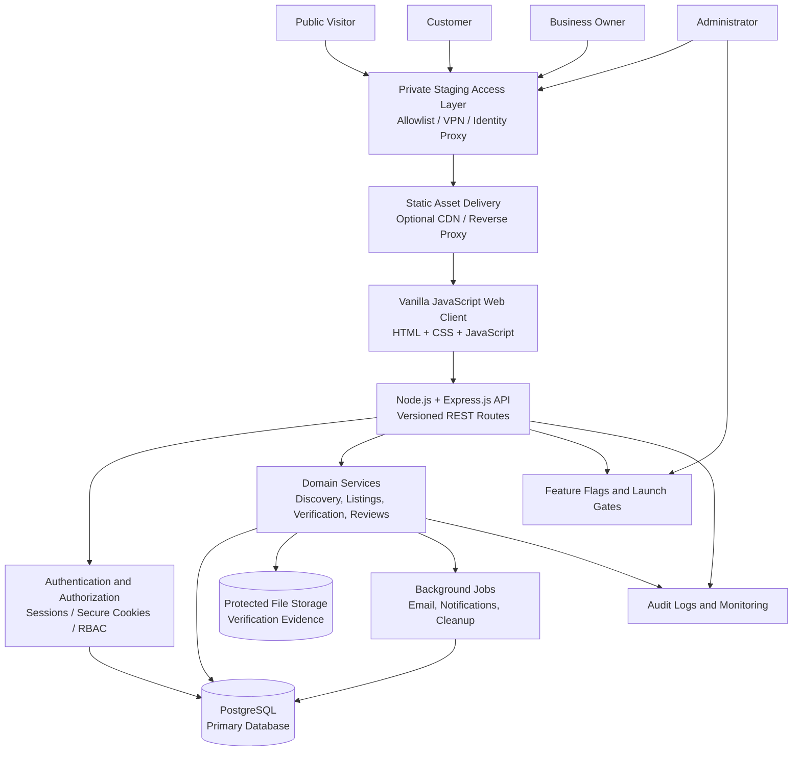

# NandedConnect System Architecture

**Product:** NandedConnect  
**Architecture phase:** Phase 2 — System Architecture Design  
**Technology direction:** Vanilla JavaScript frontend, Node.js + Express.js backend, PostgreSQL database  
**Decision status:** 34 architecture decisions (D1–D34) approved; implementation, legal validation, and operational testing remain open
**Deployment strategy:** Build completely, deploy privately, launch only after explicit product-owner approval

## 1. Architecture overview

NandedConnect will use a layered web architecture:

1. A Vanilla JavaScript client provides discovery, account, business-owner, and administrator interfaces.
2. A versioned Express.js API owns business rules, authentication, authorization, validation, moderation, and data access.
3. PostgreSQL is the system of record for users, businesses, verification, reviews, inquiries, and audit history.
4. Private staging is protected by an access-control layer and contains isolated demo/test data.
5. Public writes and public indexing are controlled by environment configuration and launch feature flags.

The existing frontend remains the initial client baseline. Its static mock data and browser-only state will be migrated behind API contracts without changing the product behavior unnecessarily.

## 2. Architecture diagram



In production, the access layer is removed or narrowed only for approved public visitor surfaces. Registration and write workflows remain independently gated until launch approval.

## 3. Proposed project structure

The current repository is a static frontend. The following structure is the target monorepo layout; backend folders can be introduced without deleting the existing client baseline.

```text
NandedConnect/
├── .github/
│   └── workflows/
│       ├── ci.yml
│       ├── security.yml
│       └── deploy-staging.yml
├── .vscode/
│   └── settings.json
├── client/
│   ├── index.html
│   ├── data.js                 # temporary migration/demo data only
│   ├── script.js
│   ├── style.css
│   ├── assets/
│   └── tests/
├── server/
│   ├── src/
│   │   ├── app.js
│   │   ├── server.js
│   │   ├── config/
│   │   ├── routes/
│   │   ├── controllers/
│   │   ├── services/
│   │   ├── repositories/
│   │   ├── middleware/
│   │   ├── validators/
│   │   ├── policies/
│   │   ├── jobs/
│   │   ├── errors/
│   │   └── utils/
│   ├── migrations/
│   ├── seeds/
│   │   ├── demo/
│   │   └── test/
│   ├── tests/
│   └── package.json
├── database/
│   ├── schema/
│   ├── migrations/
│   ├── seeds/
│   └── README.md
├── docs/
│   ├── PRODUCT_REQUIREMENTS.md
│   ├── SYSTEM_ARCHITECTURE.md
│   ├── API_CONTRACTS.md
│   ├── SECURITY.md
│   ├── OPERATIONS.md
│   └── LAUNCH_READINESS.md
├── infra/
│   ├── staging/
│   ├── production/
│   ├── reverse-proxy/
│   └── monitoring/
├── scripts/
│   ├── migrate.js
│   ├── seed-demo.js
│   └── verify-environment.js
├── .env.example
├── .gitignore
└── README.md
```

The current files remain preserved until the client migration is deliberately planned:

- [`index.html`](../index.html)
- [`data.js`](../data.js)
- [`script.js`](../script.js)
- [`style.css`](../style.css)

## 4. Responsibility boundaries

### Frontend — Vanilla JavaScript

- Render responsive pages and reusable interface patterns.
- Manage route display and client navigation.
- Send requests to the versioned API.
- Display loading, empty, validation, unauthorized, forbidden, and server-error states.
- Keep only non-sensitive UI preferences locally.
- Never decide authorization or verification status.
- Never store passwords or long-lived authentication secrets in localStorage.
- Clearly label demo/test content and unavailable functionality.

### Backend — Node.js + Express.js

- Authenticate users and establish secure sessions.
- Authorize every protected operation using roles and resource ownership.
- Validate and normalize all input server-side.
- Apply business rules for listing, ownership, verification, reviews, and inquiries.
- Provide pagination, filtering, sorting, and bounded search endpoints.
- Coordinate database transactions and background jobs.
- Enforce launch flags and staging restrictions.
- Produce structured errors and audit security-sensitive actions.

### Database — PostgreSQL

- Store canonical product data and relationships.
- Enforce foreign keys, unique constraints, check constraints, and indexes.
- Store moderation and verification state transitions.
- Preserve audit history and required soft-deleted records.
- Support transactional workflows and reliable migrations.
- Remain isolated per environment; staging and production never share a database.

## 5. Node.js + Express.js backend architecture

The backend should use a modular layered design:

```text
HTTP request
  → security middleware
  → request ID and logging middleware
  → authentication middleware
  → authorization policy
  → route validator
  → controller
  → domain service
  → repository / transaction
  → PostgreSQL
  → response serializer
```

### Recommended modules

- `auth`: registration, login, logout, sessions, verification, password reset.
- `users`: profiles, privacy, deletion requests, role assignments.
- `businesses`: discovery, details, ownership, drafts, listing status.
- `categories`: category management and public taxonomy.
- `localities`: Nanded locality management and filtering.
- `verification`: evidence, review queue, decisions, expiry, rechecks.
- `reviews`: creation, moderation, reports, and removal.
- `inquiries`: customer-to-business messages, status, and access control.
- `admin`: moderation, configuration, feature flags, audit views.
- `health`: liveness, readiness, database, migration, and dependency checks.

Controllers should remain thin. Domain services should contain business rules. Repositories should own SQL and transaction boundaries. No route should access the database directly.

## 6. PostgreSQL architecture

PostgreSQL is the source of truth. Use UUID identifiers, UTC timestamps, migrations, and environment-specific databases.

### Main schema areas

- Identity: `users`, `user_profiles`, `roles`, `user_roles`, sessions/tokens.
- Discovery: `businesses`, `categories`, `localities`, `business_locations`, `business_contacts`, `business_hours`, `business_services`.
- Ownership and workflow: `business_owners`, `business_submissions`, `verification_requests`, `verification_documents`.
- Engagement: `favorites`, `recently_viewed`, `reviews`, `inquiries`, `notifications`, `reports`.
- Governance: `audit_logs`, `feature_flags`, `launch_approvals`, `deletion_requests`, `system_events`, moderation state history.
- Notifications: recipient-specific `notifications` for authenticated users or explicitly scoped guest inquiry recipients.
- Manager access: `business_memberships` plus inquiry-specific `inquiry_assignments` conceptually authorize manager access.
- Guest inquiry security: reusable guest identities, `guest_otp_challenges`, inquiry-scoped sessions, and token revocation state.
- Business content: media metadata and private object-storage references.

### Query and integrity requirements

- Index business status, category, locality, normalized search fields, and updated timestamps.
- Use unique constraints for normalized emails, category names, and user/business favorites.
- Use foreign keys for all ownership and engagement relationships.
- Use transactions for approval, rejection, ownership, and multi-record edits.
- Use PostgreSQL Full-Text Search with `pg_trgm` indexes for the initial implementation. Keep search configuration and ranking tunable for later evolution.
- Store verification-document metadata and protected storage references, not uncontrolled public file paths.
- Use migrations for schema changes and test both forward migration and rollback/recovery procedures.

### Approved domain decisions

- **Retention:** Active accounts remain while active. Deleted-account personal data is targeted for deletion within 30 days of a verified request. Guest inquiries are retained for 24 months after last activity, with earlier complete deletion after a verified guest request. Documented legal holds and mandatory retention requirements are exceptions. Security logs are retained for 90 days, administrator audit logs for 12 months, and backups for 30 days. Guest inquiry retention is approved; automated enforcement and legal/privacy review remain incomplete.
- **Business verification:** Use phone OTP plus manual administrator review of business details and appropriate supporting evidence. GST or Aadhaar is not universally required. Verification must state what was checked and must not imply endorsement.
- **Business ownership:** Use one primary business owner initially, with future manager support. Claims and transfers require verification and administrator approval. Model ownership as a role-bearing relationship so manager support can be added without a redesign.
- **Reviews:** Require authentication, use a public display name, allow one review per customer per business, support editing, reporting, and moderation, and do not make unsupported verified-purchase claims.
- **Inquiries:** Provide database-backed two-way inquiry messaging plus direct WhatsApp/call actions where valid. Apply reusable guest identity, inquiry-scoped sessions, owner/assigned-manager access restrictions, contact privacy, audit logging, rate limits, and spam protection.

## 7. REST API design

Use a versioned prefix such as `/api/v1`. Responses should use consistent envelopes and machine-readable error codes.

### Conventions

- `GET` reads resources.
- `POST` creates a resource or starts an action.
- `PATCH` partially updates a resource.
- `DELETE` removes or archives a resource according to policy.
- Use plural resource names and stable IDs.
- Use cursor or bounded page pagination for collections.
- Use explicit query parameters for search, category, locality, sort, and status.
- Return `201` for successful creation, `202` for queued workflows, `204` for successful no-content operations.
- Return `400` for malformed input, `401` for unauthenticated requests, `403` for insufficient permissions, `404` for unavailable resources, `409` for conflicts, `422` for validation failures, and `429` for rate limits.
- Include a request ID in responses and logs.

### Proposed endpoint groups

```text
GET    /api/v1/health
GET    /api/v1/businesses
GET    /api/v1/businesses/:businessId
GET    /api/v1/categories
GET    /api/v1/localities

POST   /api/v1/auth/register             # disabled until launch approval
POST   /api/v1/auth/login                # staging-only before launch
POST   /api/v1/auth/logout
POST   /api/v1/auth/password-reset/request
POST   /api/v1/auth/password-reset/confirm
GET    /api/v1/me
PATCH  /api/v1/me
DELETE /api/v1/me

GET    /api/v1/me/favorites
POST   /api/v1/me/favorites/:businessId
DELETE /api/v1/me/favorites/:businessId
GET    /api/v1/me/recently-viewed

POST   /api/v1/business-submissions       # disabled until launch approval
GET    /api/v1/owner/businesses
GET    /api/v1/owner/businesses/:businessId
PATCH  /api/v1/owner/businesses/:businessId
POST   /api/v1/owner/businesses/:businessId/submit
GET    /api/v1/owner/inquiries

POST   /api/v1/businesses/:businessId/reviews       # launch-gated
PATCH  /api/v1/reviews/:reviewId
DELETE /api/v1/reviews/:reviewId
POST   /api/v1/businesses/:businessId/inquiries     # launch-gated

GET    /api/v1/admin/submissions
POST   /api/v1/admin/submissions/:submissionId/approve
POST   /api/v1/admin/submissions/:submissionId/reject
POST   /api/v1/admin/submissions/:submissionId/request-changes
POST   /api/v1/admin/businesses/:businessId/suspend
GET    /api/v1/admin/audit-logs
GET    /api/v1/admin/feature-flags
PATCH  /api/v1/admin/feature-flags/:flag
```

Public discovery endpoints must return only approved, publishable records. Owner and administrator endpoints must use server-side authorization and must not rely on hidden frontend controls.

## 8. Authentication and authorization design

Use custom authentication implemented by Node.js, Express.js, and PostgreSQL with secure server-managed sessions. One account may hold multiple roles. Access tokens are not the selected initial architecture.

Required controls:

- Passwords hashed with Argon2id.
- Secure, HttpOnly, SameSite cookies if cookie sessions are used.
- CSRF protection for cookie-authenticated state-changing requests.
- Email verification and expiring single-use password reset tokens when enabled.
- Login throttling, progressive delays, and suspicious activity logging.
- Server-side RBAC for `customer`, `business_owner`, and `administrator` roles.
- Resource-level ownership policies for businesses, inquiries, reviews, and documents.
- Admin actions require explicit authorization and audit logging.
- No authentication secrets or passwords in localStorage, frontend source, URLs, or logs.

Pre-launch authentication can be enabled for approved staging testers only. Public registration remains disabled until owner approval. Administrator permissions must be restricted through explicit server-side policies.

### Guest inquiry identity and session lifecycle

Guest identity is reusable after successful phone OTP verification, but access is always scoped to an individual inquiry. The system must not use one guest session as blanket authorization for all inquiries.

1. A guest starts or resumes an inquiry and completes OTP verification. OTPs are valid for 5 minutes, allow at most 5 incorrect attempts, enforce a 60-second resend cooldown, and allow at most 5 resends per hour per phone number. OTP values are never stored in plaintext.
2. Successful verification creates a new inquiry-scoped session. Each session has a 30-minute inactivity timeout and a 24-hour absolute lifetime. After either expiry, the session is invalid and fresh OTP verification is required; expired sessions are never revived.
3. The session uses a cryptographically random opaque access token in a Secure, HttpOnly, SameSite cookie. Only a token hash is stored in PostgreSQL; the token is never stored in localStorage.
4. Guest messages and authenticated business-owner/assigned-manager replies form a two-way conversation. Full guest contact information is available only to the authorized business owner and assigned managers for that business’s inquiries. Application-level encryption protects guest contact information, and every sensitive access is audit-logged.
5. After every successfully processed message, the guest token rotates. Rotation must use atomic message/token updates, tolerate concurrent requests and retries, enforce idempotency, and prevent more than one valid successor token.
6. A guest can request complete inquiry deletion after fresh OTP verification. Deletion covers the inquiry, associated messages, and personal contact information, subject to documented legal holds and mandatory retention requirements.
7. System events and notifications are separate from `inquiry_messages` and never rotate guest tokens. Guest notification reads require an active inquiry-scoped session for the same reusable guest identity and inquiry; fresh OTP verification creates a new session, while expiry or revocation denies access without deleting notification history.

## 9. Security and error-handling architecture

### Request security

- Helmet or equivalent security headers.
- Strict CORS allowlist by environment.
- Body-size, upload-size, and request-time limits.
- Rate limiting by IP and account-sensitive action.
- Input validation with shared schemas.
- Parameterized SQL through the repository layer.
- Output encoding and safe serialization.
- File type, size, malware, and access checks for verification uploads.

### Error handling

Use one application error model:

```json
{
  "error": {
    "code": "VALIDATION_ERROR",
    "message": "The submitted fields are invalid.",
    "requestId": "request-id"
  }
}
```

The API should have a final error middleware that maps known application errors to safe responses, logs unexpected errors with a request ID, and never exposes stack traces or secrets to clients.

The frontend should handle network failures, expired sessions, forbidden actions, rate limits, validation errors, and maintenance mode with clear user-facing states.

## 10. Private staging and deployment architecture

### Environments

```text
Local development
  → CI validation
  → Private staging
  → Production infrastructure provisioned but launch-gated
```

### Private staging controls

- **Approved staging stack:** Render Static Site for the client, Render Free Node.js service for the API, Neon PostgreSQL, and Cloudflare Access for staging access. Initial target budget is ₹0–₹500/month.
- Free-tier limitations such as sleeping services, quotas, compute limits, connection limits, storage limits, egress limits, backup scope, and reliability must be documented and verified against current provider terms before relying on them.
- Protect the staging host with VPN, allowlist, identity-aware proxy, or equivalent access control.
- Protect APIs independently with authentication, authorization, rate limits, validation, and environment-level access controls. Frontend hiding and `noindex` do not provide API security.
- Use a separate PostgreSQL database, credentials, storage bucket, and secrets.
- Seed only clearly labeled demo/test records.
- Disable public registration, submissions, reviews, inquiries, and notifications.
- Configure `X-Robots-Tag: noindex, nofollow` and a restrictive `robots.txt`.
- Keep launch feature flags disabled by default.
- Do not expose staging links through public marketing or navigation.
- Monitor errors, health, authentication events, moderation actions, and audit logs.
- Maintain daily independent encrypted backups with 30-day retention. Target RPO is 24 hours and target RTO is 8 hours; restore testing is required. Exact implementation, encryption-key ownership, and measured results remain open.

### Deployment pipeline

1. Install dependencies with lockfiles.
2. Run linting, unit tests, integration tests, accessibility tests, and security scans.
3. Build or package the client and server.
4. Validate required environment variables and secret sources.
5. Run database migrations against the target environment.
6. Deploy application services.
7. Run health and smoke tests.
8. Confirm launch gates remain disabled.
9. Publish staging status only to authorized stakeholders.

Rollback must include application version rollback, migration safety, database backup verification, and feature-flag recovery.

## 11. Development sequence and dependencies

### Sequence

1. Freeze and document current frontend behavior and data provenance.
2. Decide repository layout and client migration strategy.
3. Create server foundations, configuration validation, logging, health routes, and error handling.
4. Provision isolated PostgreSQL development and staging databases.
5. Add migrations for identity, taxonomy, businesses, locations, contacts, and services.
6. Import existing business/category/locality data as explicitly labeled seed data.
7. Implement public discovery endpoints and connect Explore, Categories, and Details to the API.
8. Implement authentication and customer account workflows behind staging access.
9. Implement favorites, recently viewed, profiles, and preferences.
10. Implement business owner drafts, claims, submissions, services, and listing status.
11. Implement administrator moderation and verification workflows.
12. Implement reviews, inquiries, reporting, notifications, and audit views.
13. Add security hardening, observability, performance testing, accessibility testing, and recovery drills.
14. Deploy private staging and complete the launch-readiness checklist.
15. Obtain explicit owner approval before enabling public access or public writes.

### Dependencies

- API contracts depend on final domain and authorization decisions.
- Business owner workflows depend on identity, ownership, and business-submission schemas.
- Reviews and inquiries depend on authenticated users, approved businesses, and moderation policies.
- Public search depends on approved listing status and database indexes.
- File verification depends on protected storage and retention policy.
- Public launch depends on security review, monitoring, backups, legal content, and owner approval.

## 12. Approved architecture decision baseline

The product owner approved the following architecture decisions. They supersede earlier provisional alternatives in this document:

1. **Custom authentication:** Node.js, Express.js, and PostgreSQL will provide custom authentication. One account may hold multiple roles. Use secure server-managed PostgreSQL sessions, secure cookies, Argon2id password hashing, and restricted administrator permissions.
2. **Retention:** Retain active accounts while active; target deletion of deleted-account personal data within 30 days of a verified request; retain guest inquiries for 24 months after last activity, with earlier deletion after a verified guest request. Documented legal holds and mandatory retention requirements are exceptions. Retain security logs 90 days, administrator audit logs 12 months, and backups 30 days. Guest inquiry retention is approved; legal/privacy review and automated enforcement remain incomplete.
3. **Search:** Use PostgreSQL Full-Text Search and `pg_trgm` initially.
4. **Verification:** Use phone OTP plus manual administrator review of business details and appropriate supporting evidence. Do not require GST or Aadhaar universally.
5. **Ownership:** Use one primary business owner initially, with future manager support. Claims and transfers require verification and administrator approval.
6. **Reviews:** Require authentication, use a public display name, allow one review per customer per business, support editing, reporting, and moderation, and make no unsupported verified-purchase claims.
7. **Inquiries:** Provide two-way inquiry messaging for authenticated customers or OTP-verified guests and direct WhatsApp/call actions where valid. Enforce owner/assigned-manager access restrictions, inquiry-scoped guest sessions, contact privacy, audit logging, rate limits, and spam protection.
8. **Hosting:** Use Render Static Site, Render Free Node.js backend, Neon PostgreSQL, and Cloudflare Access for private staging, targeting ₹0–₹500/month initially. Free-tier limitations must be documented and verified.
9. **Recovery:** Use daily independent encrypted backups retained for 30 days, target RPO 24 hours and RTO 8 hours, and perform restore testing.
10. **Launch control:** Require explicit product-owner approval and feature flags. No public launch or public writes before approval.

11. **Search configuration:** Use PostgreSQL simple text search plus `pg_trgm`, with multilingual testing before production use.
12. **Identifiers/extensions:** Use UUIDv4 via `gen_random_uuid()` and only the minimum necessary PostgreSQL extensions.
13. **OTP:** Use a provider-independent adapter; use mock OTP only in private staging and never send accidental real messages from staging.
14. **Evidence:** Use private object storage for verification evidence; PostgreSQL stores metadata and protected object references only.
15. **Inquiry access:** Allow authenticated customers or OTP-verified guests, with restricted owner/assigned-manager access, inquiry-scoped sessions, contact privacy, audit logging, rate limits, spam controls, and direct contact actions where valid.
16. **Managers:** Provide limited business manager permissions; the primary owner retains ownership, transfer, verification, and manager-control authority.
17. **Database authorization:** Combine application authorization with selective PostgreSQL RLS for high-risk data.
18. **Hosting posture:** Use free-tier-first private staging and upgrade when measured capability, security, reliability, or recovery needs require it.
19. **Legal gate:** Qualified legal/privacy review is mandatory before public launch; it is not complete.
20. **Recovery ownership:** The Product Owner owns initial backup and recovery operations; restore testing and operational readiness remain incomplete.

21. **Deletion requests:** Use a separate `deletion_requests` entity for guest or authenticated-customer requests, covering requester identity, related inquiry/account, OTP verification status/time where required, statuses (`Pending`, `Verified`, `Processing`, `Completed`, `Rejected`), legal holds, mandatory-retention exceptions, processing timestamps, and audit information.
22. **Guest OTP challenges:** Use a separate `guest_otp_challenges` entity tied to reusable guest identity. Store only a secure OTP hash; enforce five-minute validity, five incorrect attempts, 60-second resend cooldown, five resends per hour per phone number, verification status/time, consumed/expired states, and single-use successful verification.
23. **RLS security:** Protected backend operations use database transactions and set server-validated identity in transaction-local context using `SET LOCAL` or `set_config(..., true)`. Protected queries use the same connection and transaction, with commit/rollback before pool return. Missing/invalid context denies access. The runtime application database role must not own ANY database tables and must not have BYPASSRLS. Application authorization and selective RLS both enforce access. Security review and pooler compatibility testing remain pending.
24. **Limited manager permissions:** Managers may view business profiles, edit permitted fields, and view/respond only to assigned inquiries. They cannot add/remove managers, transfer ownership, delete businesses, change owner security settings, or approve business verification. Access is business-specific and assignment-based; maximum manager count and detailed conflict/transfer rules remain unresolved.
25. **Launch approval audit:** Use a separate `launch_approvals` entity recording approval ID, authorized approver, timestamp, environment, launch scope, approved feature flags, previous/new configuration references, rollback reference, approval status, and audit history. Public launch remains disabled without explicit product-owner approval.
26. **Notifications, reports, and media:** Provide in-app notifications for inquiry messages, status updates, and important account events; abuse reports for businesses, reviews, and inquiries with admin moderation status; and business media metadata/storage references in PostgreSQL. Actual files remain in private object storage with no public media URLs or unrestricted access.
27. **Immediate guest-token revocation:** Revoking an inquiry-scoped guest session immediately invalidates its token before expiry. Revocation is transactionally persisted, later token requests are rejected, and sensitive revocation actions are audit-logged.

Decisions 21–34 below are the approved D21–D34 addendum and do not alter D1–D20.

Private staging must remain protected independently at the access layer and API layer. Frontend hiding and `noindex` are not security controls. Public registration, business submissions, reviews, inquiries, and indexing remain disabled until launch approval. These decisions do not complete legal review or establish production readiness.

## 13. Remaining implementation decisions and risks

The product decisions are approved, but these implementation details remain open:

1. Exact session cookie names, device/session management, and CSRF implementation. Guest inquiry session lifetimes, cookie properties, token hashing, and rotation requirements are approved; concurrency/idempotency implementation and testing remain open.
2. Production phone OTP provider, sender identity, cost controls, and operational integration. Guest OTP validity, attempt limits, resend cooldown, resend cap, fresh-verification requirement, and plaintext-prohibition are approved; provider-specific abuse monitoring remains open.
3. Exact evidence types, upload limits, malware scanning, storage encryption, signed-URL duration, object-storage provider, and evidence deletion workflow. Private object storage with PostgreSQL metadata only is approved.
4. PostgreSQL simple-search configuration: language dictionaries, multilingual corpus, ranking weights, normalization, `tsvector` maintenance, and `pg_trgm` thresholds. The technology choice is approved; tuning remains open.
5. Exact role names and permission matrix for multi-role accounts and future business managers. Limited managers and primary-owner control are approved; detailed scopes remain open.
6. Ownership claim evidence, duplicate-business handling, transfer process, and dispute escalation procedure.
7. Review moderation queue rules, reporting thresholds, public display-name policy, edit history, and deletion handling.
8. Inquiry notification provider, WhatsApp link format, exact contact-encryption/key-management design, message limits, and abuse workflow. Reusable guest identity, inquiry-scoped access, two-way messaging, owner/manager access, audit logging, deletion scope, and retention are approved; notification and implementation details remain open.
9. Render, Neon, and Cloudflare account ownership, region availability, free-tier quotas, sleep/scale behavior, egress limits, and upgrade triggers. Free-tier-first is approved; provider capabilities must be verified rather than assumed.
10. Backup implementation, independent storage location, encryption-key ownership, restore automation, measured RPO/RTO, and Product Owner runbook succession. Product Owner initial responsibility is approved; execution is incomplete.
11. Completion of qualified legal/privacy review of retention, deletion, OTP, evidence, privacy, terms, reviews, and communications requirements. The mandatory pre-launch gate is approved; the review is not complete. Automated retention/deletion enforcement is also not implemented.
12. CI/CD provider, monitoring provider, alert thresholds, and production approval workflow.
13. Exact launch feature flags, approval record, rollback process, and operational runbook for enabling public access and public writes. Explicit approval and feature flags are approved; launch has not been approved.
14. Whether the existing frontend remains at the repository root or moves into the proposed `client/` directory.

The D21–D34 product decisions are approved. Their detailed schema, pooler compatibility, security review, operational testing, provider selection, and launch implementation remain open where stated; they do not establish implementation or production readiness.

**D28 — Schema-readiness addendum:** Approve conceptual ERD synchronization, D23 database role/RLS security corrections, missing entity relationships, and schema-critical constraints. D1–D27 remain unchanged. This authorizes documentation-only schema-readiness work, not SQL, migrations, database changes, or deployment.

29. **D29 — Inquiry assignments:** Use a separate conceptual `inquiry_assignments` entity or relationship linking manager users, businesses, and inquiries. Business membership authorization and inquiry-specific assignment are both required; physical and constraint details remain OPEN.
30. **D30 — Inquiry ownership XOR:** Require exactly one authenticated customer or guest identity, enforced by a PostgreSQL database-level XOR invariant and authorized backend-controlled write path. Exact implementation details remain OPEN.
31. **D31 — Message sender XOR:** Require exactly one authenticated-user or guest-session sender, enforced at the database level and through an authorized backend path handling inquiry scope, RLS, token rotation, idempotency, and audit/retention workflows. System events remain separate under D32; detailed implementation remains OPEN.
32. **D32 — System events separate from inquiry messages:** Keep human-authored inquiry messages separate from workflow/status/assignment events, reminders, and important account events. System events do not rotate guest tokens; timeline-visible system senders require separate approval. Remaining event details are OPEN.
33. **D33 — Separate system events and notifications:** Use durable canonical `system_events` and recipient-specific `notifications`; one event may produce zero, one, or many notifications. Transactional in-app writes, idempotent creation, and retry-safe processing are permitted for MVP; outbox/queue details remain OPEN.
34. **D34 — Hybrid guest notification identity and authorization:** Reusable guest identity is the durable guest recipient identity, explicit inquiry/resource scope is required, and an active inquiry session is temporary read authorization rather than notification ownership. Expired or revoked sessions deny reads; fresh OTP creates a new session without deleting or reassigning history. Remaining recipient, RLS, visibility, delivery, deletion, retention, legal-hold, and idempotency details remain OPEN.

## 14. Architecture acceptance criteria

The architecture is ready for implementation when:

- The API, database, authorization, and verification boundaries are approved.
- The staging access and launch-gate design prevents accidental public launch.
- Data migration preserves useful existing business information and provenance.
- Every protected operation has a server-side authorization policy.
- Error, audit, backup, restore, monitoring, and rollback plans are testable.
- The selected technical decisions above are documented.
- The product-owner launch approval requirement is enforced operationally, not only documented.

This document defines the architecture direction and does not itself authorize public launch.
